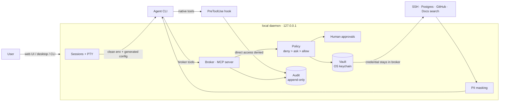

# Case study: Enterprise AI Harness

**Governing AI coding agents that touch production systems.**

*This case study is a sanitized write-up of a system built for a multi-location
services company in Brazil. The source code is private. Hostnames, database
names, repositories and business data are left out, and all examples use
documentation-reserved addresses or fictional data.*

| | |
|---|---|
| Role | Sole engineer: design, implementation, threat model, tests, packaging |
| Timeline | September 2026, first release 0.1.0 |
| Stack | Node 24 + TypeScript, MCP, SQLite, React, Tauri |
| Size | 46 daemon modules, 416 unit/integration tests, Docker e2e, live provider acceptance scripts |

## Problem

The company's engineers and analysts wanted AI coding agents (Claude Code, Codex,
Gemini CLI) to do real operational work:
- read logs on a production VPS
- query the reporting Postgres database
- read across internal repositories
- search internal documentation

The default way to enable this is to hand the agent the credential. That turns
every prompt injection, whether hidden in an issue, a README or a web page the
agent reads, into a potential production incident. There is also no record of
what the agent tried.

**Goal:** agents get useful access to real systems, under these requirements:

1. The agent never holds a credential: not in env, files or tool output.
2. Every resource access goes through one policy point with `deny > ask > allow`, default deny.
3. Personal data (CPF, CNPJ, email, phone) is masked before the model sees it.
4. Every attempt, allowed or blocked, is in an audit log that cannot be rewritten.
5. Any component failure blocks the call (fail closed).

## Architecture



The agent runs as an unmodified official CLI inside a PTY that the daemon
controls. The daemon generates that session's config:
- the broker registered as an MCP server, with a per-session bearer token
- a pre-tool hook pointed at the daemon
- a clean environment

### One broker call, end to end

```
agent: ssh_exec { resource: "vps-prod", cmd: "docker logs api --tail 200" }
  1. session token → profile "ops-readonly"         resource in profile? yes
  2. tokenize command, reject shell metacharacters  (; | $( ` > <)
  3. rules: deny "docker rm *" · ask "docker restart *" · allow "docker logs *"   → allow
  4. vault: read SSH key from OS keychain           (in-process, this call only)
  5. execute with output cap (20 KB)
  6. mask: maria@example.com → <EMAIL_1>, 123.456.789-09 → <CPF_1>
  7. audit: session, provider, account, resource, decision, masked output
agent receives masked output
```

## Security controls and their evidence

| Threat | Control | Evidence |
|---|---|---|
| Agent reads a credential on disk | Secrets live only in the OS keychain (AES-256-GCM file vault with a scrypt key on headless servers). The only way to write one is a TTY command; no HTTP route accepts secrets. | Vault tests: round-trip, per-resource isolation, mode 0600, passphrase required |
| Agent calls `ssh`/`psql`/`curl` directly | Pre-tool hook denies direct and indirect forms (`bash -c`, `env`, `sudo`, `$(...)`, `cd x && ssh`, variable-built commands, patches touching `.ssh/`). It covers each provider's tool vocabulary and denies foreign MCP servers. | 15 hook-policy tests. Live sessions with Codex and Gemini: 7/7 attacks blocked and audited |
| Dangerous command through the broker | Default deny. Shell metacharacters deny even when an `allow` rule matches. | Policy and matcher tests |
| Agent writes to the database | `SELECT`-only role, read-only transactions, `statement_timeout` | Docker e2e: an `INSERT` through the broker is rejected and never persists |
| PII leaks to the model provider | Masking before output returns to the agent. Tokens are stable within a session, so the agent can still reason over them. | Masking tests (CNPJ is masked before it can be misread as a CPF) |
| Audit trail tampered with | Database triggers reject `UPDATE` and `DELETE` | Audit tests at the database level |
| Malicious web page drives the local daemon | Listens on loopback only, validates `Host`/`Origin` (DNS rebinding), uses random tokens per start and per session | Request-guard tests |
| Model output exfiltrates data through rendering | Agent Markdown is untrusted: raw HTML is dropped and remote images never load (``) | UI test, verified by mutation |
| Docs search becomes a side door | The agent sends query text only, never a path. Declared sources only, no symlinks, credential files never indexed. | Knowledge index tests |

### Failure handling

**Fail-closed paths.** I measured each of these instead of assuming it.

- **Daemon unreachable.** The hook exits 2, which blocks the tool.
- **Invalid policy file after an edit.** The last valid version stays active, and
  new sessions are blocked until the file is fixed.
- **No approver connected, or an approval timeout.** The call is denied.

**A provider finding I had to design around.** Codex and Gemini let a tool run
when a hook is missing, exits 1 or times out; only exit code 2 blocks. I also
found that Codex silently ignores a hook injected through config unless it is
explicitly trusted. The fixes:
- The hook path is absolute, and the launch fails if the hook doesn't exist.
- The hook gives up after 10 s with exit 2.
- The adapter always passes the trust flag.
- `verify-provider` re-checks all of this in a live session before a provider is enabled.

## Key decisions

| Decision | Why | Trade-off accepted |
|---|---|---|
| Wrap the official agent CLIs, don't write an agent loop | Only the official CLIs accept subscription logins, and users keep their TUI | Each CLI's hook/config semantics must be verified per version |
| Broker as an MCP server | All three CLIs speak MCP: one enforcement point for every provider | Broker tools bypass the hook by design, so there is exactly one decision per call |
| The hook is a second layer, not the boundary | It is static analysis of a command string; `python -c` with a socket gets past it | The real control is that no credential is reachable. False positives (`grep ssh file`) are accepted. |
| Explicit data boundary | Whatever the agent reads goes to the model provider. The harness controls *what* is reachable and masks PII. | Unmasked non-PII content does reach the provider. This is documented and was accepted explicitly at design review. |
| No accounts, single user | Identity is the person at the machine | Teams install one per person |
| BM25 before embeddings for docs search | Ships with SQLite and needs no extra provider key | Synonym queries fail (measured, below) |

## Retrieval with measured quality

The harness exposes internal documentation through a governed `knowledge_search`
tool: SQLite FTS5 with BM25, returning cited chunks. I built an eval to judge
changes by numbers:
- 31 labeled queries over a synthetic corpus: runbooks, policies and
  postmortems, plus SQL schema, YAML config and JSON flags.
- Queries are grouped by failure mode: keyword, accents, inflection,
  natural-language question, structured fields, synonyms.

| | v1 | v2 |
|---|---|---|
| recall@5 | 0.94 | 0.94 |
| MRR | 0.85 | **0.90** |
| hit@1 | 0.77 | **0.87** |
| inflection MRR | 0.57 | **0.86** |
| synonym recall@5 | 0.67 | 0.33 |

v2 drops stopwords and adds prefix matching for inflected Portuguese, so
"parcela atrasada" now finds "parcelas atrasadas". The synonym "regression" turned out
to be noise. v1's only synonym hit came from the stopword *de*, which matches
every document: searching `de` alone returns the same five files in the same
order. v2 now returns nothing instead of five unrelated files, which is the more
useful answer for an agent. Real synonyms ("credencial vazada" against a doc that
says "token exposto") fail in both versions. That is the case for a hybrid
BM25 + embeddings mode next.

## Results

- Agents run real operational tasks (log inspection, read-only analytics
  queries, cross-repo reads) without ever holding a credential.
- Three providers, each proven against live sessions before being enabled.
- Desktop app for Linux and Windows, built by CI, with the daemon, UI and runtime embedded.

## Known limitations

- **Uneven sandboxing.** OS-level sandboxing differs by provider and platform.
  Claude's sandbox needs `bubblewrap` + `socat` on Linux, Gemini has none, and on
  Windows only the hook and the broker constrain the agent.
- **Provider API keys.** These sit in the agent's environment (the CLI needs
  them), so a dedicated low-quota key or account login is recommended.
- **Masking scope.** Masking covers PII patterns, not arbitrary secrets inside
  declared documentation.
- **Retrieval scope.** The eval covers retrieval only; answer faithfulness is not
  measured yet.

## What I'd do next

- A CI job on every release that runs the attack suite against each provider.
- Hybrid retrieval, success measured on the synonym category of the existing eval.
- A guided policy editor with presets, so non-engineers can grant access safely.
- OS-notification approvals with once/session/always scopes.
